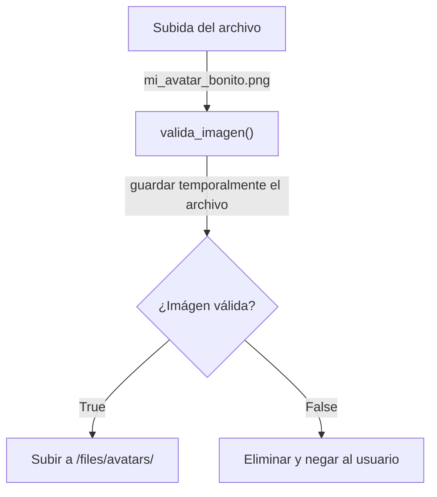
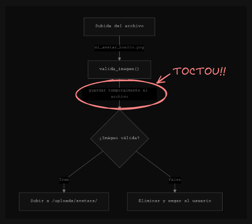
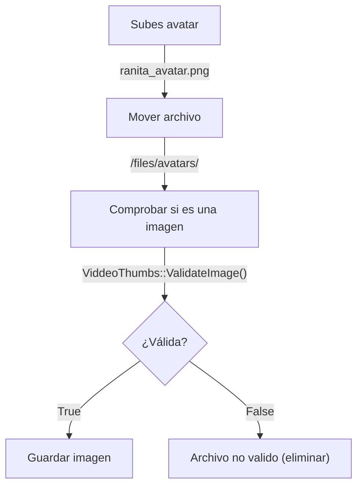
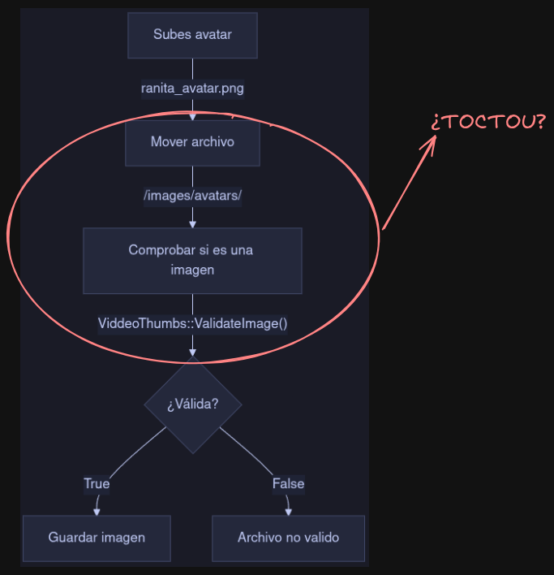
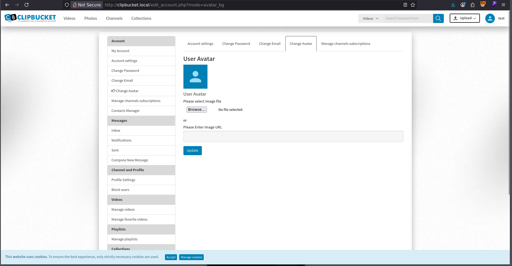
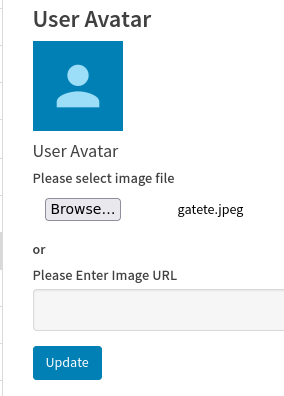
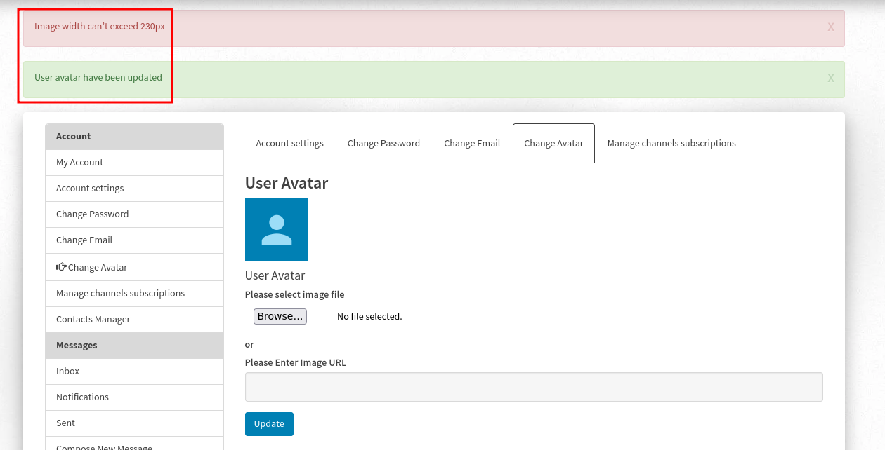

> Esto es una revisión de un CVE, no soy el autor de este hallazgo. Divulgo por diversión :)

# Sigue en proceso...

## ¿Qué es ClipBucket?

[ClipBucket](https://github.com/MacWarrior/clipbucket-v5) es una herramienta desarrollada por [@MacWarrior](https://github.com/MacWarrior), el objetivo de *ClipBucket* es permitir que el usuario pueda montar su propia aplicación de videos *(como plataformas famosas como Youtube)* de manera local y gratuita.

*ClipBucket* emplea PHP *(mal momento para usarlo en 2026)* para la lógica del back-end.

## CVE-2026-25728

### Descripción
La funcionalidad de subir una imagen de fondo en el avatar es vulnerable a **Time-of-Check to Time-of-Use** o también denominado TOCTOU.

#### ¿Qué es el Time-of-Check to Time-of-Use?
*Time-of-Check to Time-of-Use* es un [Race Condition](https://community.owasp.org/pages/vulnerabilities/race_conditions) que ocurre cuando la aplicación esta comprobando el estado o permisos de un recurso.

Imaginemos el siguiente proceso al subir un archivo en la aplicación:



En este caso un atacante podría aprovechar ese momento exacto donde la aplicación mientras valida el archivo lo guarda de manera temporal en el directorio. Pudiendo explotar *TOCTOU* de manera sencilla.



## Análisis de la causa
Todo esto empieza en el flujo `upload_user_file()` alojado en `upload.class.php:838-843`:

```php
if (move_uploaded_file($file['tmp_name'], $file_path)) {
    if (!VideoThumbs::ValidateImage($file_path, $ext)) {
        e(lang('Invalid file type'));
        @unlink($file_path);
        return false;
    }
}
```

El flujo que sigue esta verificación es la siguiente:





Como vemos la aplicación sube temporalemnte nuestro archivo dando igual si es válido o no al directorio de avatars. Con esto un atacante podría explotar un Race Condition para que de forma paralela se esté validando el archivo realizar una solicitud a él para ejecutar comandos ya que deja un margen para que en esa *race window* donde está validando si es una imagen válida nuestro archivo está subido en `/files/avatars/`.

Para que quede más claro vamos a verlo! En el Proof-Of-Content.

## Proof Of Content
Vamos a ir a la visualización de nuestro perfil:



Ahora vamos a darle a `Upload cover` e intentemos subir un archivo PHP:

*cmd.php*:
```php
<?php system($_GET[0]); ?>
```

Lo que hace este script es pillar el valor del parámetro `0` por el método `GET` y ejecutarlo como comando del sistema con la función `system()`.

Vamos a subir una imagen normal:



Ahora le daremos a `Upload`:


Vemos que nos da 2 mensajes:
1. Imagen excede el máximo de pixeles
2. La imagen se ha subido con éxito

Pero vemos que la imagen no carga así que es un falso positivo. Si subimos una imagen 200x200 px podremos encontrar donde se almacenan las imagenes:


## Referencias
- GitHub Advisory --> https://github.com/MacWarrior/clipbucket-v5/security/advisories/GHSA-xq7c-m5r2-9wqj
- Owasp Race Conditions --> https://community.owasp.org/pages/vulnerabilities/race_conditions