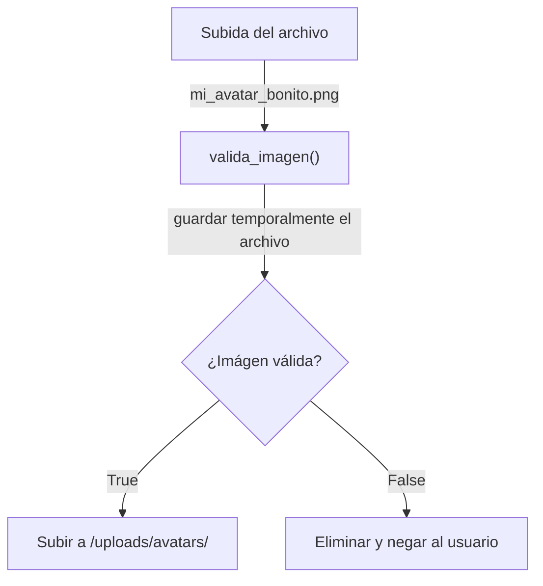

> Esto es una revisión de un CVE, no soy el autor de este hallazgo. Divulgo por diversión :)

# Sigue en proceso...

## ¿Qué es ClipBucket?

[ClipBucket](https://github.com/MacWarrior/clipbucket-v5) es una herramienta desarrollada por [@MacWarrior](https://github.com/MacWarrior), el objetivo de *ClipBucket* es permitir que el usuario pueda montar su propia aplicación de videos *(como plataformas famosas como Youtube)* de manera local y gratuita.

*ClipBucket* emplea PHP *(mal momento para usarlo en 2026)* para la lógica del back-end.

## CVE-2026-25728

### Descripción
La funcionalidad de subir una imagen de fondo en el avatar es vulnerable a **Time-of-Check to Time-of-Use** o también denominado TOCTOU.

#### ¿Qué es el Time-of-Check to Time-of-Use?
*Time-of-Check to Time-of-Use* es un [Race Condition](https://community.owasp.org/pages/vulnerabilities/race_conditions) que ocurre cuando la aplicación esta comprobando el estado o permisos de un recurso.

Imaginemos el siguiente proceso al subir un archivo en la aplicación:

## Referencias
- GitHub Advisory --> https://github.com/MacWarrior/clipbucket-v5/security/advisories/GHSA-xq7c-m5r2-9wqj
- Owasp Race Conditions --> https://community.owasp.org/pages/vulnerabilities/race_conditions

Proceso.