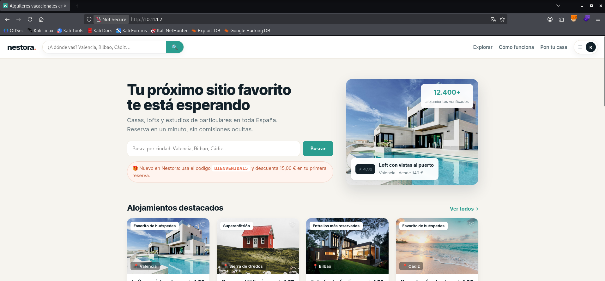
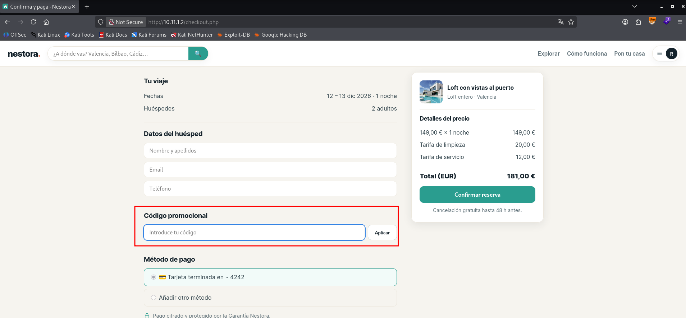
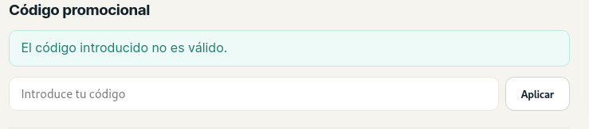
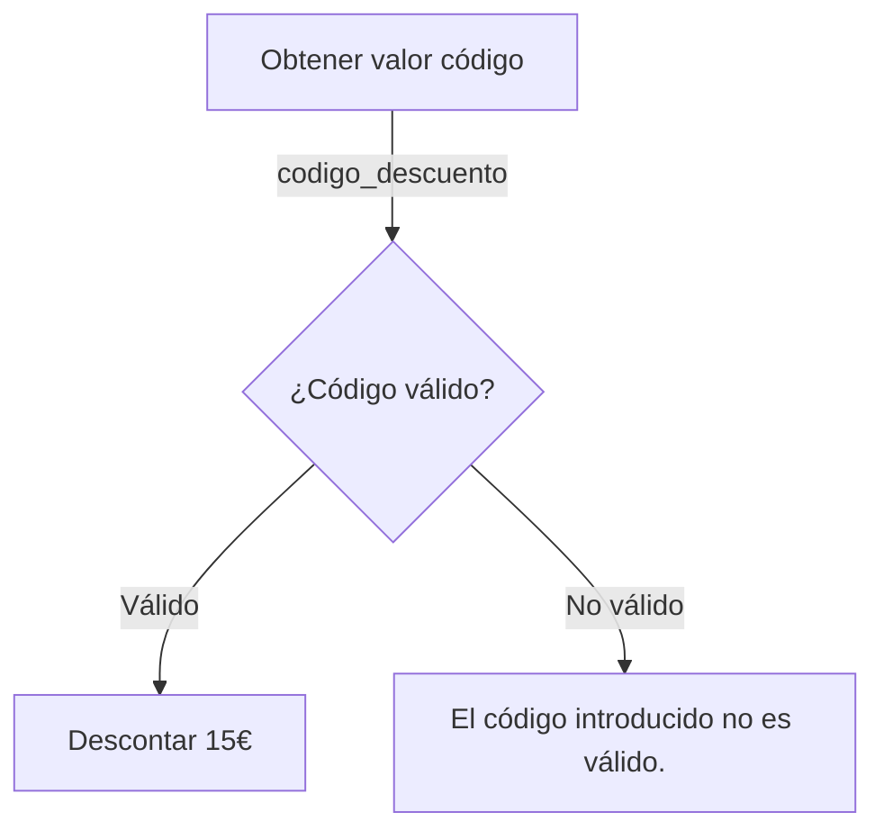
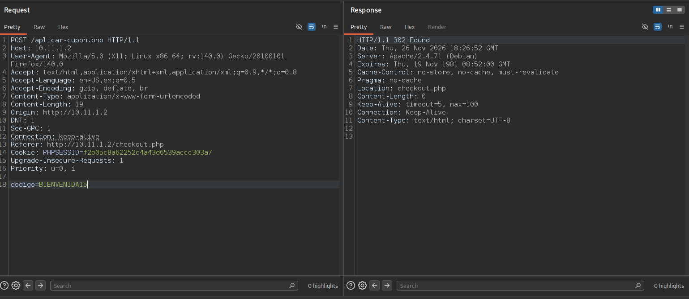
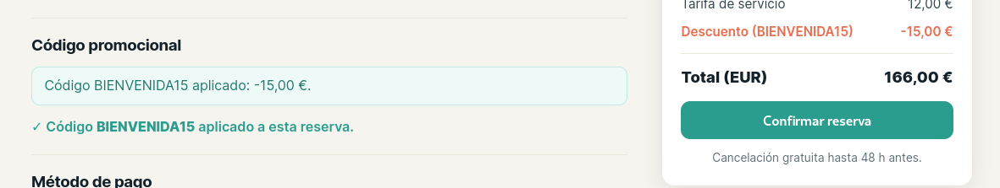
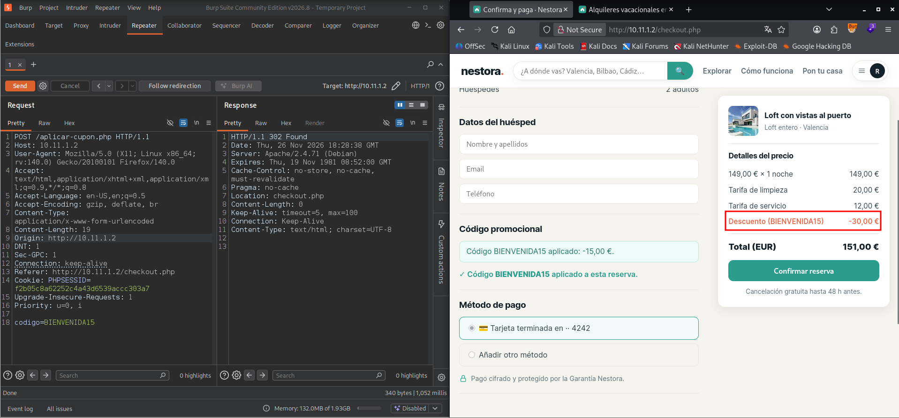
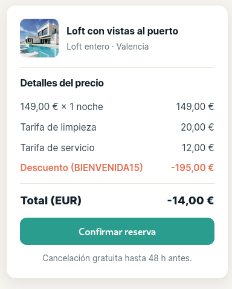
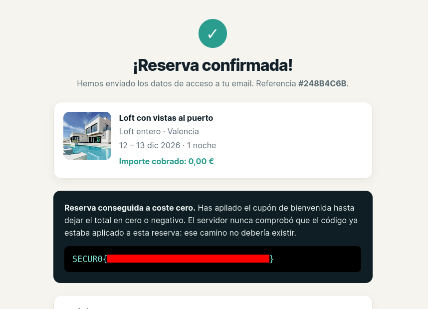

Vamos a ver la aplicación web:



Vemos que se trata de una web de alquiler de viviendas. Podemos ver que nos dan un código de descuento de bienvenida `BIENVENIDA15`. Vamos a ver donde lo podemos canjear:



Vamos a canjear un código al azar de manera erronea para ver su flujo:



Se realiza una solicitud por el método `POST` donde se envía el valor del campo:

```
POST /aplicar-cupon.php HTTP/1.1

Host: 10.11.1.2
User-Agent: Mozilla/5.0 (X11; Linux x86_64; rv:140.0) Gecko/20100101 Firefox/140.0
Accept: text/html,application/xhtml+xml,application/xml;q=0.9,*/*;q=0.8
Accept-Language: en-US,en;q=0.5
Accept-Encoding: gzip, deflate, br
Content-Type: application/x-www-form-urlencoded
Content-Length: 14
Origin: http://10.11.1.2
DNT: 1
Sec-GPC: 1
Connection: keep-alive
Referer: http://10.11.1.2/checkout.php
Cookie: PHPSESSID=f2b05c8a62252c4a43d6539accc303a7
Upgrade-Insecure-Requests: 1
Priority: u=0, i

codigo=test123
```

Respuesta del servidor:

```
HTTP/1.1 302 Found

Date: Thu, 26 Nov 2026 18:14:55 GMT
Server: Apache/2.4.71 (Debian)
Expires: Thu, 19 Nov 1981 08:52:00 GMT
Cache-Control: no-store, no-cache, must-revalidate
Pragma: no-cache
Location: checkout.php
Content-Length: 0
Keep-Alive: timeout=5, max=100
Connection: Keep-Alive
Content-Type: text/html; charset=UTF-8

```

El flujo que puede estar siguiendo en el back-end es el siguiente:



Algo que podríamos intentar es canjear mediante un Race Condition 2 veces el código de descuento. Pero no funcionará en este caso, ya que si nos fijamos la aplicación emplea sesiones PHP, donde ya vienen con una implementación donde evitan que un usuario pueda realizar varios flujos al mismo tiempo con 1 misma sesión. Evitando algunos Race Conditions. 

Vamos a probar a canjear normalmente el código de descuento:





Vemos que se canjeo exitosamente, pero... ¿Qué pasa si intentamos canjearlo nuevamente? vamos a comprobarlo:



Vemos que podemos canjearlo nuevamente el descuento!! Vamos a canjearlo hasta dejarlo a un precio absurdo:



Vamos a alquilarlo:



---