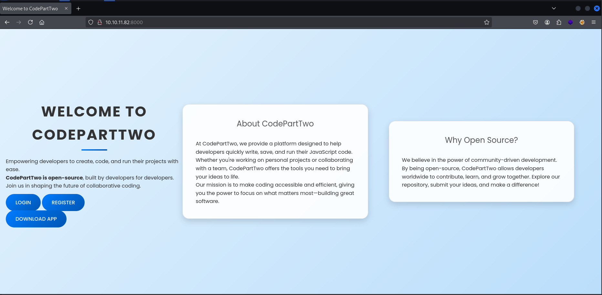

## Enumeration

Vamos a empezar con un escaneo `nmap` :

```bash
┌──(pylon㉿kali)-[10.10.14.209]-[~/Desktop/pylon/HTB/nmap]
└─$ nmap -p- --open -sS -n -Pn -vvv --min-rate=5000 10.10.11.82
Starting Nmap 7.95 ( <https://nmap.org> ) at 2025-09-17 18:36 CEST
Initiating SYN Stealth Scan at 18:36
Scanning 10.10.11.82 [65535 ports]
Discovered open port 22/tcp on 10.10.11.82
Discovered open port 8000/tcp on 10.10.11.82
Completed SYN Stealth Scan at 18:36, 12.24s elapsed (65535 total ports)
Nmap scan report for 10.10.11.82
Host is up, received user-set (0.044s latency).
Scanned at 2025-09-17 18:36:15 CEST for 12s
Not shown: 64536 closed tcp ports (reset), 997 filtered tcp ports (no-response)
Some closed ports may be reported as filtered due to --defeat-rst-ratelimit
PORT     STATE SERVICE  REASON
22/tcp   open  ssh      syn-ack ttl 63
8000/tcp open  http-alt syn-ack ttl 63

Read data files from: /usr/share/nmap
Nmap done: 1 IP address (1 host up) scanned in 12.30 seconds
           Raw packets sent: 67795 (2.983MB) | Rcvd: 64627 (2.585MB)
```

Vemos el puerto `22` y `8000` . Vamos a realizar un segundo escaneo para averiguar que servicio y en que version corre en cada puerto:

```bash
┌──(pylon㉿kali)-[10.10.14.209]-[~/Desktop/pylon/HTB/nmap]
└─$ nmap -p22,8000 -sCV 10.10.11.82
Starting Nmap 7.95 ( <https://nmap.org> ) at 2025-09-17 18:38 CEST
Nmap scan report for 10.10.11.82
Host is up (0.044s latency).

PORT     STATE SERVICE VERSION
22/tcp   open  ssh     OpenSSH 8.2p1 Ubuntu 4ubuntu0.13 (Ubuntu Linux; protocol 2.0)
| ssh-hostkey: 
|   3072 a0:47:b4:0c:69:67:93:3a:f9:b4:5d:b3:2f:bc:9e:23 (RSA)
|   256 7d:44:3f:f1:b1:e2:bb:3d:91:d5:da:58:0f:51:e5:ad (ECDSA)
|_  256 f1:6b:1d:36:18:06:7a:05:3f:07:57:e1:ef:86:b4:85 (ED25519)
8000/tcp open  http    Gunicorn 20.0.4
|_http-server-header: gunicorn/20.0.4
|_http-title: Welcome to CodePartTwo
Service Info: OS: Linux; CPE: cpe:/o:linux:linux_kernel

Service detection performed. Please report any incorrect results at <https://nmap.org/submit/> .
Nmap done: 1 IP address (1 host up) scanned in 8.26 seconds
```

|**PUERTO**|**SERVICIO**|
|---|---|
|`22/TCP`|**OpenSSH 8.2p1**|
|`8000/TCP`|**Gunicorn 20.0.4**|

Vemos que el puerto `8000` corre `Gunicorn` , vamos a ver que es:

